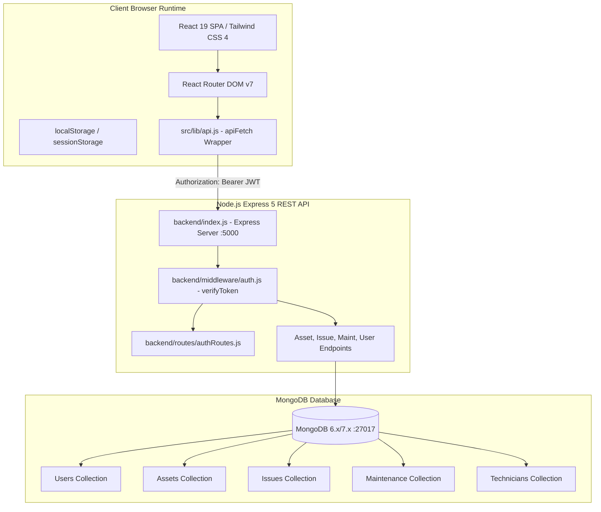
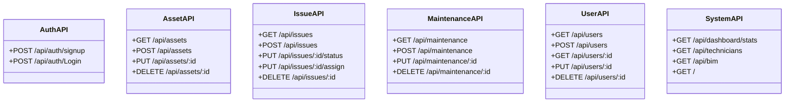
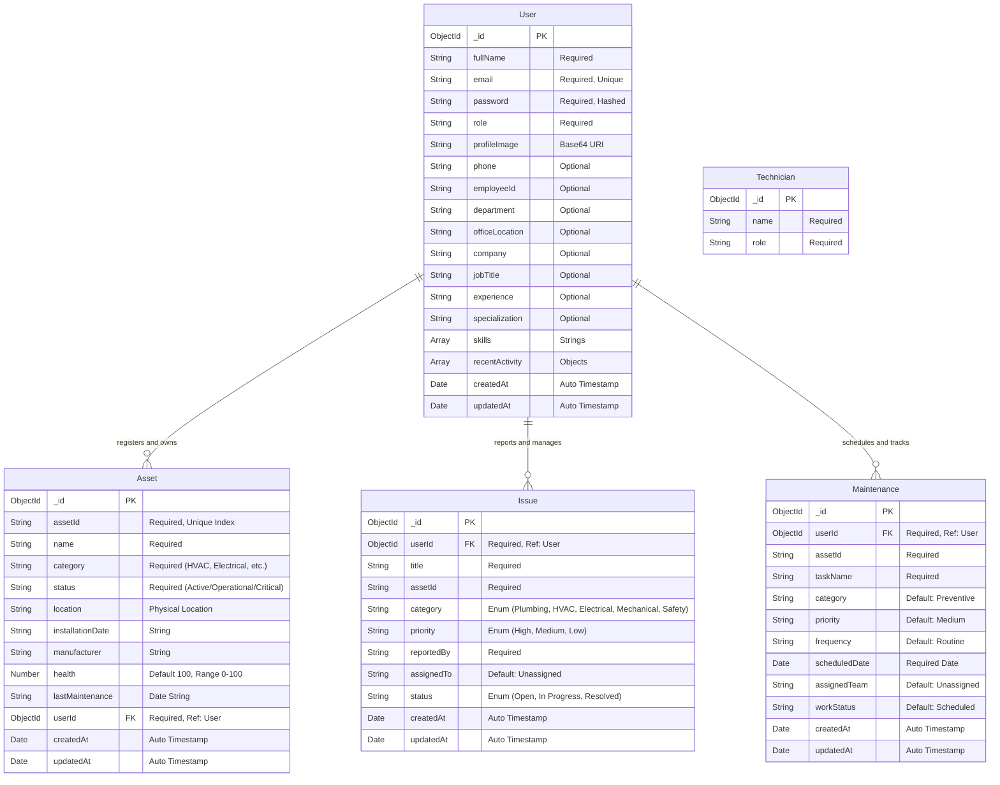

# SOFTWARE REQUIREMENTS SPECIFICATION (SRS)
## BIM Facility Management System (Smart BIM FM Platform)

---

### DOCUMENT CONTROL

| Attribute | Details |
| :--- | :--- |
| **Document Title** | Detailed Software Requirements Specification (SRS) |
| **Project Name** | BIM Facility Management System (`bim-management`) |
| **Document Identifier** | SRS-BIM-FM-2026-IA3 |
| **Current Version** | 1.0.0 |
| **Date of Publication** | October 29, 2026 |
| **Author / Lead Auditor**| Senior Software Engineer & Software Architect |
| **Target Assessment** | IA3 Software Engineering Assessment — Condition 2 |
| **Document Status** | Final / Verified against Codebase |
| **Repository Path** | `E:\SE_Project\Software_Engineering` |

---

## 1. INTRODUCTION

### 1.1 Purpose
This Software Requirements Specification (SRS) provides a comprehensive, technically rigorous description of the **BIM Facility Management System** (`bim-management`). It formally details the functional requirements, non-functional requirements, external interface definitions, data schemas, use-case models, and traceability mappings for the application as implemented in the project repository. This document serves as the formal baseline for development, verification, and academic assessment for the college IA3 Software Engineering examination.

### 1.2 Scope
The **BIM Facility Management System** is a full-stack web application developed using the MERN architecture (React 19, Node.js, Express 5, and MongoDB via Mongoose 9). The application serves as an operations management hub for commercial and industrial facilities.
- **In-Scope Capabilities**:
  - Secure identity management (self-registration, credential authentication with bcrypt hashing, and JSON Web Token authorization).
  - Multi-tenant, user-scoped hardware asset registry supporting creation, reading, editing, deletion, and CSV export.
  - Incident triage and issue tracking with priority tagging, status workflow transitions, and field technician assignments.
  - Preventative maintenance (PM) work order creation, due-date tracking, auto-overdue detection, and task completion.
  - Facility operational analytics rendering equipment health distributions, planned vs. unplanned expenditures, and priority allocations via Recharts.
  - Spatial wireframe representation of building infrastructure with 2D/3D zoom, rotate, and component selection controls.
  - Administrative user directory management and personal profile customizers with direct Base64 avatar persistence.
- **Out-of-Scope / Excluded Capabilities**:
  - Live native WebGL/IFC binary geometric parsing (the current viewer uses a simulated 2D SVG wireframe with CSS transforms).
  - Direct hardware/IoT sensor protocol integration (telemetry is simulated and retrieved via REST APIs).
  - Payment processing and external billing gateway integration.

### 1.3 Project Objectives
1. **Centralize Building Operations**: Consolidate disparate hardware asset ledgers, defect reports, and maintenance calendars into a single accessible portal.
2. **Prevent Equipment Downtime**: Implement preventative maintenance scheduling and condition scoring (0–100%) to flag degrading machinery prior to catastrophic failure.
3. **Facilitate Accountability**: Implement direct issue-to-technician assignment workflows with status audit trails.
4. **Data Portability**: Enable automated client-side RFC 4180 CSV report generation for regulatory compliance and physical facility audits.

### 1.4 Intended Audience
- **Academic Evaluators & Assessors**: Reviewing compliance against IA3 Software Engineering grading criteria.
- **Software Engineers & Developers**: Maintaining and extending codebase functionality.
- **System Administrators**: Deploying, configuring, and maintaining backend servers and MongoDB clusters.
- **Facility Managers & Field Technicians**: Operating the web interface during day-to-day building maintenance.

### 1.5 Definitions, Acronyms, and Abbreviations

| Term / Acronym | Definition |
| :--- | :--- |
| **BIM** | Building Information Modeling. A digital representation of physical and functional characteristics of a facility. |
| **MERN** | Software stack comprising MongoDB, Express.js, React, and Node.js. |
| **JWT** | JSON Web Token. An open standard (RFC 7519) for securely transmitting information between parties as a JSON object. |
| **CRUD** | Create, Read, Update, Delete. The four fundamental operations of persistent storage. |
| **HVAC** | Heating, Ventilation, and Air Conditioning. |
| **VAV** | Variable Air Volume. An HVAC component that regulates airflow at a constant temperature. |
| **AHU** | Air Handling Unit. Large commercial device used to regulate and circulate air. |
| **MEP** | Mechanical, Electrical, and Plumbing engineering systems in building design. |
| **LOD** | Level of Detail / Level of Development in BIM models (e.g., LOD 400). |
| **SPA** | Single Page Application. A web application that interacts with the user by dynamically rewriting the current web page. |
| **RFC 4180** | Common Format and MIME Type for Comma-Separated Values (CSV) Files. |
| **ODM** | Object Data Modeling (e.g., Mongoose for MongoDB). |
| **Base64** | Binary-to-text encoding schemes that represent binary data in an ASCII string format. |

---

## 2. OVERALL DESCRIPTION

### 2.1 Product Perspective
The BIM Facility Management System is a self-contained, client-server web application. The frontend runs in evergreen web browsers as an interactive Single Page Application (SPA), while the backend operates as a decoupled Node.js Express REST API server connected to a MongoDB document database.

### 2.2 Major Product Functions
1. **User Identity & Access Management**: Secure registration with password entropy scoring, login with bcrypt password verification, role matching, and 7-day signed JWT issuance.
2. **Operations Dashboard**: Centralized dashboard compiling user-scoped asset counts, active defect breakdowns, today's due maintenance routines, floor-by-floor health distributions, and monthly spend curves.
3. **Hardware Asset Registry**: Full lifecycle management of physical equipment, including unique alphanumeric IDs, category domains, physical floor locations, condition health scores, and CSV exports.
4. **Defect & Incident Tracking**: Work ticket management allowing defect reporting, inline status updates (`Open`, `In Progress`, `Resolved`), and technician assignment.
5. **Preventative Maintenance Scheduling**: Automated routine planning with interval tagging (Monthly, Quarterly, Annually), target dates, and auto-overdue detection.
6. **Simulated BIM Spatial Viewer**: Interactive viewport displaying a 2D/3D building wireframe with rotation, zoom scaling, dynamic category filters, and component telemetry inspection.
7. **User Directory & Profile Management**: Administration directory with account creation, deletion, personal profile customization, and Base64 avatar persistence.
8. **Telemetry Analytics**: Statistical asset condition aggregation, maintenance compliance tracking, and critical asset triage tables.

### 2.3 User Classes and Characteristics

| User Class | Description & Technical Capability | Permissions & Access Scope |
| :--- | :--- | :--- |
| **Facility Manager** | Primary operational actor overseeing physical plant hardware, budgeting, and maintenance teams. | Read/Write access to all owned assets, maintenance work orders, issues, and analytics reports. Can export data and assign technicians. |
| **Technician** | Field operational staff executing repairs, filter replacements, and equipment inspections. | Read access to assigned hardware assets, ability to transition issue workflows (`In Progress`, `Resolved`) and mark maintenance routines as completed. |
| **Administrator** | Technical administrator managing platform accounts, role provisioning, and system settings. | Full platform access, including user provisioning (`POST /api/users`), user deletion (`DELETE /api/users/:id`), and system-level configuration. |

### 2.4 Operating Environment
- **Client Tier**:
  - Operating System: Platform independent (Windows 10/11, macOS, Linux).
  - Web Browser: Google Chrome 110+, Mozilla Firefox 110+, Microsoft Edge 110+, Safari 16+.
  - Display Resolution: Optimized for 1280x720 and higher; responsive layouts support mobile viewports down to 360px width.
- **Server Tier**:
  - Runtime: Node.js version `>=18.0.0` (tested on Node `v24.14.0`).
  - Web Framework: Express `^5.2.1` configured with ECMAScript Modules (`"type": "module"`).
  - Port Allocation: Default port `5000` (configurable via `PORT` environment variable).
- **Database Tier**:
  - Database Engine: MongoDB Community Server `>=6.0.0` or MongoDB Atlas cloud cluster.
  - Connection Driver: Mongoose `^9.7.2`.
  - Default Port: `27017`.

### 2.5 Design and Implementation Constraints
1. **No External UI Component Libraries**: UI built with pure Tailwind CSS 4 utility classes without third-party component suites (e.g., Material UI, Ant Design, Chakra UI).
2. **Stateless JWT Storage**: Authentication tokens are stored in browser `localStorage` and sent via `Authorization: Bearer <token>`.
3. **Simulated Wireframe Viewport**: The BIM viewer uses mathematical SVG geometry and CSS transforms (`scale()`, `rotate()`) rather than WebGL or Three.js canvas loaders.
4. **Multi-Tenant User Isolation**: All hardware assets, issues, and maintenance records enforce strict user scoping via `userId: req.user.id` in backend Mongoose queries.
5. **Base64 Payload Ceiling**: Profile images are uploaded as Base64 strings directly to MongoDB; `express.json({ limit: '10mb' })` enforces a 10MB request body ceiling.

### 2.6 Assumptions and Dependencies
- A local or remote MongoDB service is running and accessible via the connection string in `backend/.env`.
- Client web browsers have JavaScript and Web Storage (`localStorage` and `sessionStorage`) enabled.
- Network connectivity allows communication between the Vite client server (`http://localhost:5173`) and Express backend (`http://localhost:5000`).

---

## 3. FUNCTIONAL REQUIREMENTS

### 3.1 Module 1: Authentication and Session Security

#### [FR-001] User Registration
- **Description**: The system shall allow new users to register an account with their full name, email, password, and system role.
- **Actor**: Unregistered User.
- **Preconditions**: User is on the `/signup` route; email must not already exist in the database.
- **Expected Behavior**:
  1. The user inputs Full Name, Email, Password, Confirm Password, and selects a Role ("Facility Manager", "Technician", "Administrator").
  2. The client calculates and displays a password strength meter (Weak, Medium, Strong).
  3. On submit, the client validates that all fields are non-empty, email matches RFC regex, password is $\ge 8$ characters, and passwords match.
  4. The system sends a `POST /api/auth/signup` request with `{ fullName, email, password, role }`.
  5. The backend validates schema constraints, generates a salt (10 rounds), hashes the password via bcrypt, and saves the document to MongoDB.
  6. The client displays a success notification and redirects to `/` (Login).
- **Postconditions**: A new user record is saved in MongoDB with an encrypted password hash.
- **Status**: **Implemented**.

#### [FR-002] User Authentication (Login)
- **Description**: The system shall verify user credentials and issue an authorization token upon valid login.
- **Actor**: Registered User.
- **Preconditions**: User account exists in MongoDB.
- **Expected Behavior**:
  1. User enters email, password, and selects their operational role.
  2. User submits the login form; client dispatches `POST /api/auth/Login`.
  3. The backend queries `User.findOne({ email })`.
  4. The backend executes `bcrypt.compare()` between the input password and stored hash.
  5. The backend verifies that the requested role matches `user.role`.
  6. The backend generates a signed JWT containing `{ id: user._id, userId: user._id, role: user.role }` with a 7-day expiration.
  7. Client receives HTTP 200 containing token and user profile object; client saves token to `localStorage.getItem("token")` and redirects to `/dashboard`.
- **Postconditions**: JWT token stored in client storage; session state established.
- **Status**: **Implemented**.

#### [FR-003] Client-Side Route Protection
- **Description**: The system shall prevent unauthenticated access to protected routes.
- **Actor**: Unauthenticated User.
- **Preconditions**: `localStorage` does not contain a valid `token`.
- **Expected Behavior**: When an unauthenticated user attempts to access `/dashboard`, `/assets`, `/maintenance`, `/issues`, `/bim-viewer`, `/analytics`, `/users`, `/settings`, or `/profile`, the `ProtectedRoute` component redirects the user to `/` with HTTP state replacement.
- **Postconditions**: Access is denied; login view is rendered.
- **Status**: **Implemented**.

---

### 3.2 Module 2: Operations Dashboard & System Overview

#### [FR-004] KPI Telemetry Aggregation
- **Description**: The system shall calculate and display aggregated key performance indicators for facility health.
- **Actor**: Authenticated User.
- **Preconditions**: User is logged in; token is present.
- **Expected Behavior**:
  1. On mounting `/dashboard`, the system initiates parallel queries: `GET /api/assets`, `GET /api/maintenance`, and `GET /api/issues`.
  2. The system calculates Total Assets count, Active Issues count (status $\ne$ "Resolved"), Total Maintenance count, and Average Health Score ($\frac{\sum \text{health}}{\text{count}}$).
  3. The system renders 4 interactive KPI cards with trend indicators.
  4. Clicking any KPI card navigates the user to the corresponding module.
- **Postconditions**: Live facility metrics displayed.
- **Status**: **Implemented**.

#### [FR-005] Asset Condition Distribution by Floor
- **Description**: The system shall categorize equipment health condition by architectural building floor.
- **Actor**: Facility Manager.
- **Preconditions**: Assets with location values exist in the database.
- **Expected Behavior**:
  1. The system extracts floor location tags (e.g., "Floor 1", "Floor 2", "L1").
  2. The system categorizes assets into condition tiers: Healthy ($\ge 85\%$), Warning ($60\% \le \text{health} < 85\%$), and Critical ($< 60\%$).
  3. The system sorts building floors alphanumerically and renders a Stacked Bar Chart via Recharts.
- **Postconditions**: Multi-level condition graph rendered.
- **Status**: **Implemented**.

#### [FR-006] Maintenance Expenditure Timeline
- **Description**: The system shall compute monthly planned versus unplanned maintenance spending curves.
- **Actor**: Facility Manager.
- **Preconditions**: Maintenance work orders with dates and cost fields exist.
- **Expected Behavior**: The system aggregates expenses over a 7-month calendar horizon (Jan–Jul) partitioned into Planned and Unplanned spend, rendering a dual-line chart with currency tooltips.
- **Postconditions**: Cost trend chart displayed.
- **Status**: **Implemented**.

#### [FR-007] Secondary Dashboard Overview
- **Description**: The system shall provide a high-level summary cross-section of database metrics.
- **Actor**: Authenticated User.
- **Preconditions**: User navigates to `/dashboard-overview`.
- **Expected Behavior**: Dispatches authenticated `GET /api/dashboard/stats`; displays total hardware assets, urgent issues, tasks due today, and defect density breakdown bars with normalized scale.
- **Postconditions**: Overview telemetry displayed without 401 authorization failures.
- **Status**: **Implemented**.

---

### 3.3 Module 3: Asset Inventory & Management

#### [FR-008] Hardware Asset Registration
- **Description**: The system shall allow users to register physical hardware equipment into the facility database.
- **Actor**: Facility Manager.
- **Preconditions**: User is authenticated; Asset ID must be unique.
- **Expected Behavior**:
  1. User clicks "Add Asset" on `/assets` or "Register Asset" on `/asset-inventory`.
  2. User inputs Asset ID (e.g., "AHU-102"), Name, Category Domain, Physical Location, Initial Status ("Operational", "Maintenance", "Critical"), and Health Score (0–100%).
  3. System sends `POST /api/assets` with payload and JWT.
  4. Backend verifies token, injects `userId: req.user.id`, validates unique `assetId`, and commits to MongoDB.
  5. System re-fetches asset ledger and closes modal.
- **Postconditions**: Asset document stored in MongoDB; UI table updates.
- **Status**: **Implemented**.

#### [FR-009] Asset Search & Multi-Predicate Filtering
- **Description**: The system shall filter asset inventory records dynamically based on search strings and drop-down selectors.
- **Actor**: Authenticated User.
- **Preconditions**: Assets list loaded.
- **Expected Behavior**:
  1. User enters text in the search input; system filters matches against Name, Asset ID, or Location case-insensitively.
  2. User selects Status filter ("All Status", "Operational", "Maintenance", "Critical").
  3. User selects Category filter dynamically populated from active database records.
  4. System evaluates composite filter criteria in $\mathcal{O}(N)$ time and updates the visible rows.
- **Postconditions**: Table view updates in real-time.
- **Status**: **Implemented**.

#### [FR-010] In-Memory Asset Pagination
- **Description**: The system shall partition filtered asset records into paginated view slices.
- **Actor**: Authenticated User.
- **Preconditions**: Filtered asset count $> 0$.
- **Expected Behavior**: Divides filtered array into pages of 6 items (`PAGE_SIZE = 6`). Renders Next, Previous, and direct page numbered buttons. Controls disable at array bounds.
- **Postconditions**: Sliced page rendered.
- **Status**: **Implemented**.

#### [FR-011] Asset Record Deletion (Decommissioning)
- **Description**: The system shall permit permanent deletion of equipment records.
- **Actor**: Facility Manager.
- **Preconditions**: Target asset exists and belongs to logged-in user.
- **Expected Behavior**:
  1. User clicks the Trash icon on an asset row.
  2. Confirmation modal or prompt displays.
  3. User confirms deletion; client sends `DELETE /api/assets/:id`.
  4. Backend executes `Asset.findOneAndDelete({ _id: id, userId: req.user.id })`.
  5. Record is dropped; ledger reloads.
- **Postconditions**: Asset deleted from MongoDB.
- **Status**: **Implemented**.

#### [FR-012] RFC 4180 Asset CSV Export
- **Description**: The system shall export the active asset registry into a downloadable CSV document.
- **Actor**: Facility Manager.
- **Preconditions**: At least one asset record exists.
- **Expected Behavior**: Iterates through active asset objects; formats escaped CSV columns (Asset ID, Name, Category, Location, Status, Health Score, Last Maintenance); constructs a `data:text/csv` URI; programmatically triggers a browser download named `BIM_Asset_Report_<date>.csv`.
- **Postconditions**: CSV file downloaded to user's device.
- **Status**: **Implemented**.

---

### 3.4 Module 4: Asset Inspection & Modification

#### [FR-013] Asset Full Inspection Page
- **Description**: The system shall provide an in-depth operational inspection page for individual hardware units.
- **Actor**: Authenticated User.
- **Preconditions**: User navigates to `/asset-details`.
- **Expected Behavior**:
  1. The system reads the asset from route navigation state or recovers it from `sessionStorage.getItem("view_asset")`.
  2. If storage is empty, it parses query parameter `?id=...` and queries `GET /api/assets` to locate the asset.
  3. Displays complete equipment telemetry: Health condition progress bar, age, manufacturer, model series, installation date, warranty expiration date, and assigned technician.
  4. Renders maintenance history table and document attachments list.
- **Postconditions**: Asset details rendered reliably even across browser page refreshes.
- **Status**: **Implemented**.

#### [FR-014] Asset Record Modification (Edit Asset)
- **Description**: The system shall persist modifications made to hardware equipment parameters.
- **Actor**: Facility Manager.
- **Preconditions**: Asset exists in database.
- **Expected Behavior**:
  1. User opens `/edit-asset` from the asset registry or details page.
  2. System initializes form controls with asset values, caching data in `sessionStorage` for refresh resilience.
  3. User modifies Name, Category, Location, Status, or Health Score.
  4. User clicks "Save Changes"; client sends `PUT /api/assets/:id` with payload and JWT.
  5. Backend updates document via `Asset.findOneAndUpdate({ _id: id, userId: req.user.id })`.
  6. Client displays green success confirmation banner and redirects to `/assets`.
- **Postconditions**: Asset record updated in MongoDB.
- **Status**: **Implemented**.

---

### 3.5 Module 5: Defect & Issue Management

#### [FR-015] Defect Logging (Work Order Ticket)
- **Description**: The system shall allow users to report facility hardware incidents and defects.
- **Actor**: Authenticated User.
- **Preconditions**: Asset exists in facility.
- **Expected Behavior**:
  1. User clicks "Log Issue" on `/issues`.
  2. Enters Issue Title, Target Asset ID, Category ("Plumbing", "HVAC", "Electrical", "Mechanical", "Safety"), Priority ("High", "Medium", "Low"), and Reported By name.
  3. Client dispatches `POST /api/issues`.
  4. Backend validates enum fields and saves document with default status "Open".
  5. Issue board reloads and displays the new ticket.
- **Postconditions**: Issue record saved in MongoDB.
- **Status**: **Implemented**.

#### [FR-016] Inline Issue Status Workflow Transition
- **Description**: The system shall support immediate workflow status updates via table dropdown selectors.
- **Actor**: Technician / Facility Manager.
- **Preconditions**: Target issue exists.
- **Expected Behavior**:
  1. User changes the Status dropdown selector on an issue row from "Open" to "In Progress" or "Resolved".
  2. Client immediately dispatches `PUT /api/issues/:id/status` with `{ status: nextStatus }`.
  3. Backend updates the document and responds with HTTP 200.
  4. Status badge and table state update reactively.
- **Postconditions**: Issue status updated in MongoDB.
- **Status**: **Implemented**.

#### [FR-017] Issue Technician Assignment
- **Description**: The system shall allow facility managers to assign responsible technicians to active issues.
- **Actor**: Facility Manager.
- **Preconditions**: Issue exists; technician roster available.
- **Expected Behavior**:
  1. User clicks "Assign Staff" on an issue row.
  2. System queries `GET /api/technicians` to populate available staff (falling back to default roster if empty).
  3. User selects technician or inputs custom staff name.
  4. Client dispatches `PUT /api/issues/:id/assign` with `{ assignedTo: staffName }`.
  5. Backend persists assignment; table row updates.
- **Postconditions**: Issue assigned in database.
- **Status**: **Implemented**.

#### [FR-018] Issue Record Deletion
- **Description**: The system shall allow deletion of resolved or invalid defect logs.
- **Actor**: Facility Manager.
- **Preconditions**: Target issue exists.
- **Expected Behavior**: Dispatches `DELETE /api/issues/:id`; removes document matching `_id` and `userId`.
- **Postconditions**: Record deleted from MongoDB.
- **Status**: **Implemented**.

---

### 3.6 Module 6: Preventative Maintenance & Scheduling

#### [FR-019] Preventative Maintenance Task Creation
- **Description**: The system shall support scheduling routine preventative maintenance runs.
- **Actor**: Facility Manager.
- **Preconditions**: Target Asset ID specified.
- **Expected Behavior**:
  1. User fills PM modal on `/maintenance` or `/maintenance-schedule`.
  2. Enters Target Asset ID, Task Description, Frequency ("Monthly", "Quarterly", "Annually"), Target Date, and Assigned Team.
  3. Client sends `POST /api/maintenance` with JWT.
  4. Backend maps fields to Mongoose schema and commits document with default `workStatus: "Scheduled"`.
  5. Scheduler table re-fetches data.
- **Postconditions**: Maintenance record stored in MongoDB.
- **Status**: **Implemented**.

#### [FR-020] Auto-Detection of Overdue Maintenance
- **Description**: The system shall dynamically detect and flag past-due scheduled maintenance runs.
- **Actor**: System (Automated Logic).
- **Preconditions**: Maintenance records loaded into client memory.
- **Expected Behavior**: Compares `task.scheduledDate` with current date `new Date()`. If `task.workStatus !== "Completed"` and `scheduledDate < current date`, tags task status as "Overdue" and renders red alert badge.
- **Postconditions**: Overdue counter and badges reflect real-time compliance breaches.
- **Status**: **Implemented**.

#### [FR-021] Maintenance Task Completion
- **Description**: The system shall allow technicians to mark scheduled runs as completed.
- **Actor**: Technician.
- **Preconditions**: Task exists in database.
- **Expected Behavior**: Clicking "Mark Completed" dispatches `PUT /api/maintenance/:id` setting `workStatus: "Completed"`. Table status re-renders green.
- **Postconditions**: Task marked completed in MongoDB.
- **Status**: **Implemented**.

---

### 3.7 Module 7: Simulated BIM Spatial Viewer

#### [FR-022] BIM Spatial Wireframe Rendering
- **Description**: The system shall render a spatial wireframe visualization representing facility building levels.
- **Actor**: Authenticated User.
- **Preconditions**: User navigates to `/bim-viewer`.
- **Expected Behavior**:
  1. The system renders an isometric multi-tier building wireframe utilizing mathematical SVG path lines.
  2. On mount, queries `GET /api/bim` and `GET /api/assets` to populate real equipment nodes (AHU-04, Chiller Plant, Generator, Pumps, VAV boxes).
  3. Displays categorized equipment lists (HVAC, Electrical, Plumbing, Fire Safety).
- **Postconditions**: Spatial building model rendered.
- **Status**: **Implemented (Simulated Wireframe)**.

#### [FR-023] Viewport Navigation & Canvas Controls
- **Description**: The system shall allow users to interact with the building canvas using zoom, rotate, and full-screen controls.
- **Actor**: Authenticated User.
- **Preconditions**: BIM Viewer canvas mounted.
- **Expected Behavior**:
  1. Zoom In / Zoom Out modifies transform scale between 50% and 200% in 10% increments.
  2. Rotate button increments transform rotation by 45° steps.
  3. Reset button restores scale to 100% and rotation to 0°.
  4. Full Screen button invokes browser Fullscreen API.
- **Postconditions**: Canvas transform coordinates update dynamically.
- **Status**: **Implemented**.

#### [FR-024] Spatial Asset Property Inspection
- **Description**: The system shall display detailed engineering properties when an asset node is selected in the BIM viewer.
- **Actor**: Authenticated User.
- **Preconditions**: Asset exists in viewer list.
- **Expected Behavior**: Selecting an asset in the left panel updates the active node selection, renders health bar, category badge, and populates the right panel with Asset ID, Category, Floor, Installation Date, and Technician. Tabs display historical maintenance and open defect issues.
- **Postconditions**: Selected asset property card rendered.
- **Status**: **Implemented**.

#### [FR-025] BIM Asset Data JSON Export
- **Description**: The system shall export the active spatial asset tree into a JSON document.
- **Actor**: Authenticated User.
- **Preconditions**: Assets loaded in viewer.
- **Expected Behavior**: Formats asset array as indented JSON string; constructs a `data:text/json` URI; triggers browser download named `BIM_Assets_<date>.json`.
- **Postconditions**: JSON file downloaded.
- **Status**: **Implemented**.

---

### 3.8 Module 8: User Directory & Profile Management

#### [FR-026] User Directory Listing
- **Description**: The system shall display registered user accounts in an administrative directory table.
- **Actor**: Administrator.
- **Preconditions**: User has Administrator role.
- **Expected Behavior**: Dispatches `GET /api/users`; backend returns user documents excluding encrypted password hashes (`.select('-password')`); renders table with Full Name, Email, Phone, Role badge, Department, and Creation Date.
- **Postconditions**: Directory displayed.
- **Status**: **Implemented**.

#### [FR-027] Administrative User Provisioning
- **Description**: The system shall allow administrators to provision new user accounts.
- **Actor**: Administrator.
- **Preconditions**: Administrator is authenticated.
- **Expected Behavior**: Admin fills Add User modal on `/users`; sends `POST /api/users` with `{ fullName, email, phone, role, department }`; backend assigns default password `Welcome@123`, hashes password, and saves document to MongoDB.
- **Postconditions**: New user record created.
- **Status**: **Implemented**.

#### [FR-028] Administrative User Deletion
- **Description**: The system shall allow administrators to delete user accounts.
- **Actor**: Administrator.
- **Preconditions**: Target user ID exists.
- **Expected Behavior**: Dispatches `DELETE /api/users/:id`; removes user document from MongoDB.
- **Postconditions**: User deleted.
- **Status**: **Implemented**.

#### [FR-029] Personal Profile Customization
- **Description**: The system shall allow users to update their personal profile attributes.
- **Actor**: Authenticated User.
- **Preconditions**: User navigates to `/profile`.
- **Expected Behavior**: Retrieves profile via `GET /api/users/:id`; user edits job title, department, phone, emergency contact, experience, and skills; dispatches `PUT /api/users/:id` to commit changes.
- **Postconditions**: User document updated in MongoDB.
- **Status**: **Implemented**.

#### [FR-030] Base64 Profile Picture Upload
- **Description**: The system shall allow users to upload and persist a custom profile avatar.
- **Actor**: Authenticated User.
- **Preconditions**: User selects an image file from their device.
- **Expected Behavior**: Client reads file via `FileReader.readAsDataURL()`; converts image to a Base64 data string; sends `PUT /api/users/:id` with `{ profileImage: base64String }`; backend parses JSON payload (within 10MB limit) and persists string in MongoDB.
- **Postconditions**: Profile avatar persisted in database and displayed in top header.
- **Status**: **Implemented**.

---

### 3.9 Module 9: Fleet Analytics & Telemetry Reporting

#### [FR-031] Dynamic Portfolio Health Calculation
- **Description**: The system shall compute overall fleet condition index and risk stratification.
- **Actor**: Facility Manager.
- **Preconditions**: User accesses `/analytics`.
- **Expected Behavior**: Fetches assets via `GET /api/assets` and maintenance via `GET /api/maintenance`; aggregates average health score, maintenance completion percentage, and categorizes assets into Optimal ($\ge 80\%$), Warning ($50\% \le \text{score} < 80\%$), and Critical ($< 50\%$). Renders Recharts Donut chart.
- **Postconditions**: Condition analytics rendered.
- **Status**: **Implemented**.

#### [FR-032] Critical Equipment Triage Table
- **Description**: The system shall identify and display the top 5 most vulnerable hardware assets.
- **Actor**: Facility Manager.
- **Preconditions**: Asset records available.
- **Expected Behavior**: Sorts asset fleet ascending by health score (`.sort((a, b) => a.score - b.score)`); slices the first 5 records; renders a triage table displaying Asset ID, Name, Condition percentage, and Risk Status badge.
- **Postconditions**: Top critical assets highlighted.
- **Status**: **Implemented**.

---

### 3.10 Module 10: System Settings & Preferences

#### [FR-033] Local Preference Configuration
- **Description**: The system shall allow users to configure interface preferences, theme density, and notification toggles.
- **Actor**: Authenticated User.
- **Preconditions**: User navigates to `/settings`.
- **Expected Behavior**: User toggles notification preferences (Email, Maintenance Alerts, Critical Alerts), Appearance Theme (Light/Dark), Density (Comfortable/Compact), and Date Formats. Settings are saved to `localStorage.getItem("app_preferences")`.
- **Postconditions**: Preferences saved in client browser storage.
- **Status**: **Partially Implemented (Persists locally; no backend database synchronization)**.

#### [FR-034] Danger Zone Cache Clearing
- **Description**: The system shall allow users to clear cached application state and terminate sessions.
- **Actor**: Authenticated User.
- **Preconditions**: User confirms danger action modal.
- **Expected Behavior**: Executes `localStorage.clear()` and `sessionStorage.clear()`; navigates to `/` (Login).
- **Postconditions**: Local session terminated and storage purged.
- **Status**: **Implemented**.

---

## 4. NON-FUNCTIONAL REQUIREMENTS

### 4.1 Security and Authentication

| ID | Requirement Specification | Verification Evidence / Mechanism |
| :--- | :--- | :--- |
| **NFR-SEC-01** | **Salted Password Hashing**: Passwords must never be stored in plaintext. Passwords must be hashed using bcrypt with a work factor of 10 salt rounds prior to database insertion. | **Verified**: Implemented via Mongoose `pre('save')` hook in `backend/models/User.js`. |
| **NFR-SEC-02** | **Cryptographic Token Authorization**: User sessions must be secured with signed JSON Web Tokens using HMAC SHA-256 with an expiration of 7 days. | **Verified**: Generated in `backend/routes/authRoutes.js` via `jwt.sign()` and verified in `backend/middleware/auth.js`. |
| **NFR-SEC-03** | **Production Secret Guard**: In production environments, the system must abort startup if a strong `JWT_SECRET` is not set in the environment. | **Verified**: Implemented in `backend/lib/jwtSecret.js`. |
| **NFR-SEC-04** | **Multi-Tenant User Isolation**: All hardware asset, maintenance, and issue queries must filter by `userId: req.user.id` to prevent cross-account data leakage. | **Verified**: Enforced across all data endpoints in `backend/index.js`. |
| **NFR-SEC-05** | **Password Exposure Prevention**: User directory endpoints must exclude encrypted password fields from API responses. | **Verified**: `GET /api/users` applies `.select('-password')`. |

### 4.2 Usability and Accessibility
- **NFR-USA-01**: The user interface shall adhere to standard color semantics (Emerald for Operational/Healthy, Amber for Maintenance/Warning, Red for Critical/Offline/Overdue).
- **NFR-USA-02**: All data tables shall provide visual empty states (icon and descriptive prompt) when zero records match query filters.
- **NFR-USA-03**: Interactive buttons and form inputs must provide visual hover states, active transitions, and disabled states during asynchronous operations.

### 4.3 Performance
- **NFR-PER-01**: In-memory table filtering and pagination operations across hardware assets, issues, and maintenance windows must execute in $\le 50\text{ ms}$ for fleets up to 1,000 items.
- **NFR-PER-02**: Client build bundles must utilize Vite tree-shaking and dynamic code splitting to maintain lightweight asset payloads.
- **NFR-PER-03**: Recharts vector rendering must execute client-side using SVG elements rather than heavy CPU-bound bitmap canvas operations.

### 4.4 Reliability and Error Handling
- **NFR-REL-01**: The Express server shall configure DNS resolver fallbacks to `8.8.8.8` and `1.1.1.1` to prevent DNS lookup timeouts when connecting to MongoDB Atlas SRV clusters.
- **NFR-REL-02**: The frontend shall implement safe default fallbacks for all asynchronous metrics (`data.breakdown || {}`, `assets || []`) to prevent null-pointer runtime crashes.
- **NFR-REL-03**: The client routing switchboard shall define a wildcard catch-all route (`<Route path="*" ...>`) redirecting to valid routes to prevent blank screens on invalid URLs.

### 4.5 Maintainability and Code Standards
- **NFR-MNT-01**: All backend and frontend source files must use native ECMAScript Modules (`import`/`export`) without legacy CommonJS `require()` statements.
- **NFR-MNT-02**: Backend models must strictly encapsulate schema validation rules, timestamps (`timestamps: true`), and relationships using Mongoose ODM.
- **NFR-MNT-03**: HTTP requests must be channeled through a centralized API utility (`src/lib/api.js`) to eliminate redundant header and token injection boilerplate.

### 4.6 Compatibility
- **NFR-CMP-01**: The client application must render consistently across modern browser rendering engines (Blink, Gecko, WebKit).
- **NFR-CMP-02**: The backend server must run in any POSIX or Windows environment hosting Node.js `>=18.x`.

### 4.7 Data Integrity
- **NFR-DAT-01**: Unique indexes must be enforced by MongoDB on `User.email` and `Asset.assetId` to prevent duplicate primary keys.
- **NFR-DAT-02**: Issue categories and priorities must be restricted by Mongoose schema enums (`['Plumbing', 'HVAC', 'Electrical', 'Mechanical', 'Safety']` and `['High', 'Medium', 'Low']`).

---

## 5. EXTERNAL INTERFACE REQUIREMENTS

### 5.1 User Interfaces
The system provides a responsive web interface organized into 16 primary routes:

| Route Path | View / Component | Access Level | Primary UI Components |
| :--- | :--- | :--- | :--- |
| `/` | `Login.jsx` | Public | Split branding panel, role selector tabs, email/password form, sign-in CTA. |
| `/signup` | `Signup.jsx` | Public | Capability list, registration form, password entropy bar, role select. |
| `/dashboard` | `Dashboard.jsx` | Protected | KPI cards, Stacked Bar Chart, Spend Line Chart, Priority Donut Chart, activity table. |
| `/dashboard-overview` | `DashboardOverview.jsx` | Protected | Metric counters, category breakdown bars, quick module gateways. |
| `/assets` | `AssetManagement.jsx` | Protected | Filter bar, search input, CRUD modals, `<AssetAnalytics />`, CSV export. |
| `/asset-details` | `AssetDetails.jsx` | Protected | Health score banner, equipment specification grid, PM history table. |
| `/asset-inventory` | `AssetInventory.jsx` | Protected | Alternate asset ledger, hardware registration modal. |
| `/edit-asset` | `EditAsset.jsx` | Protected | Controlled asset update form with `sessionStorage` refresh resilience. |
| `/bim-viewer` | `BIMViewer.jsx` | Protected | SVG wireframe viewport, rotation/zoom toolbar, telemetry property cards. |
| `/maintenance` | `MaintenanceManagement.jsx`| Protected | Work order ledger, modal form, priority badges, delete confirmation. |
| `/maintenance-schedule`| `MaintenanceSchedule.jsx` | Protected | Preventative scheduler, interval filters, overdue auto-badges. |
| `/issues` | `IssueManagement.jsx` | Protected | Defect cards, inline status dropdown, staff assignment dialog, CSV export. |
| `/users` | `UserManagement.jsx` | Protected | Role distribution cards, user directory table, provisioning modal. |
| `/profile` | `UserProfile.jsx` | Protected | Avatar camera picker (Base64), personal details form, activity log. |
| `/settings` | `Settings.jsx` | Protected | Preference navigation, notification switches, appearance controls, danger zone. |
| `/analytics` | `Analytics.jsx` | Protected | Fleet condition donut, critical triage table, print-to-PDF trigger. |

### 5.2 Hardware Interfaces
The system does not directly interface with physical hardware controllers or field PLC units. Telemetry values (vibration, inlet temperature, damper position) are simulated and retrieved through standard REST JSON payloads.

### 5.3 Software Interfaces
1. **Browser Web Storage**:
   - `localStorage`: Stores `token` (JWT string), `user` (profile JSON), and `app_preferences`.
   - `sessionStorage`: Stores `view_asset` and `edit_asset` for refresh persistence.
2. **Node.js File System (`node:fs`)**: Used in `scripts/copy-404.js` to duplicate `dist/index.html` to `dist/404.html` for GitHub Pages SPA compatibility.
3. **Operating System Print Subsystem**: Invoked via `window.print()` in `Analytics.jsx` for PDF generation.

### 5.4 Backend REST API Interfaces

#### Detailed Endpoint Inventory

| Method | Endpoint Path | Auth Req. | Request Body / Parameters | Expected Response Status & Body | Description |
| :--- | :--- | :--- | :--- | :--- | :--- |
| `POST` | `/api/auth/signup` | No | `{ fullName, email, password, role }` | `201 { message: "User registered successfully!" }` | Registers account with bcrypt hash |
| `POST` | `/api/auth/Login` | No | `{ email, password, role }` | `200 { message, token, user }` | Authenticates and returns 7d JWT |
| `GET` | `/api/assets` | Bearer JWT | None | `200 Asset[]` | Returns user-scoped asset records |
| `POST` | `/api/assets` | Bearer JWT | `{ assetId, name, category, status, location, health }` | `201 Asset` | Creates hardware asset record |
| `PUT` | `/api/assets/:id` | Bearer JWT | Asset modification fields | `200 Asset` | Updates asset by `_id` or `assetId` |
| `DELETE` | `/api/assets/:id` | Bearer JWT | None | `200 { message, deletedAsset }` | Deletes asset matching user ownership |
| `GET` | `/api/issues` | Bearer JWT | None | `200 Issue[]` | Returns user-scoped defect issues |
| `POST` | `/api/issues` | Bearer JWT | `{ title, assetId, category, priority, reportedBy }` | `201 Issue` | Logs new defect ticket |
| `PUT` | `/api/issues/:id/status`| Bearer JWT | `{ status: "Open"|"In Progress"|"Resolved" }` | `200 Issue` | Updates ticket workflow status |
| `PUT` | `/api/issues/:id/assign`| Bearer JWT | `{ assignedTo: string }` | `200 Issue` | Assigns technician to work ticket |
| `DELETE` | `/api/issues/:id` | Bearer JWT | None | `200 { message, deletedIssue }` | Deletes defect ticket |
| `GET` | `/api/maintenance` | Bearer JWT | None | `200 Maintenance[]` | Returns preventative schedules |
| `POST` | `/api/maintenance` | Bearer JWT | `{ assetId, taskName, category, scheduledDate, ... }` | `201 Maintenance` | Creates preventative maintenance run |
| `PUT` | `/api/maintenance/:id`| Bearer JWT | Maintenance modification fields | `200 Maintenance` | Updates maintenance run |
| `DELETE` | `/api/maintenance/:id`| Bearer JWT | None | `200 { message, deletedMaint }` | Deletes maintenance run |
| `GET` | `/api/dashboard/stats` | Bearer JWT | None | `200 { totalAssets, activeIssuesCount, ... }` | Compiles aggregated system counts |
| `GET` | `/api/technicians` | Bearer JWT | None | `200 Technician[]` | Returns technician roster |
| `GET` | `/api/bim` | Bearer JWT | None | `200 { categories, assets, ... }` | Provides simulated BIM telemetry |
| `GET` | `/api/users` | Bearer JWT | None | `200 User[]` | Returns directory (no passwords) |
| `POST` | `/api/users` | Bearer JWT | `{ fullName, email, role, department, ... }` | `201 User` | Admin creates user |
| `GET` | `/api/users/:id` | Bearer JWT | Path parameter `id` | `200 User` | Retrieves user profile document |
| `PUT` | `/api/users/:id` | Bearer JWT | Profile updates or `{ profileImage }` | `200 User` | Updates profile / Base64 avatar |
| `DELETE` | `/api/users/:id` | Bearer JWT | Path parameter `id` | `200 { message }` | Deletes user account |
| `GET` | `/` | No | None | `200 "BIM Backend is live!"` | Health probe root endpoint |

### 5.5 MongoDB Database Interface
Communication between Node.js and MongoDB is handled by the official Mongoose 9 ODM over TCP/IP socket connections. Connection strings are specified via `MONGO_URI` (e.g., `mongodb://127.0.0.1:27017/bim_management` or Atlas cluster connection strings).

---

## 6. DATA REQUIREMENTS

### 6.1 Database Entity Relationship Diagram

### 6.2 Data Model Specifications

#### 1. Entity: `User` (`backend/models/User.js`)
- `_id`: `mongoose.Schema.Types.ObjectId` (Auto-generated Primary Key).
- `fullName`: `String`, required.
- `email`: `String`, required, unique constraint enforced via MongoDB index.
- `password`: `String`, required, encrypted with bcrypt.
- `role`: `String`, required ("Facility Manager", "Technician", "Administrator").
- `profileImage`: `String`, default `""` (Stores Base64 data string).
- `phone`, `employeeId`, `department`, `officeLocation`, `company`, `jobTitle`, `experience`, `specialization`: `String`, default `""`.
- `skills`: `[String]`, array of skill strings.
- `stats`: `Array`, general statistics cache.
- `recentActivity`: `Array`, array of activity objects `{ text, time, iconType }`.
- `timestamps`: `true` (automatically injects `createdAt` and `updatedAt`).

#### 2. Entity: `Asset` (`backend/models/Asset.js`)
- `_id`: `mongoose.Schema.Types.ObjectId` (Auto-generated Primary Key).
- `assetId`: `String`, required, unique index enforced.
- `name`: `String`, required.
- `category`: `String`, required (e.g., "HVAC", "Electrical", "Plumbing").
- `status`: `String`, required, default `"Active"`.
- `location`: `String` (e.g., "Floor 3, Room 302").
- `installationDate`: `String`.
- `manufacturer`: `String`.
- `userId`: `mongoose.Schema.Types.ObjectId`, `ref: 'User'`, required (Foreign Key).
- `health`: `Number`, default `100` (scale 0–100).
- `lastMaintenance`: `String`.
- `timestamps`: `true`.

#### 3. Entity: `Issue` (`backend/models/Issue.js`)
- `_id`: `mongoose.Schema.Types.ObjectId` (Primary Key).
- `userId`: `mongoose.Schema.Types.ObjectId`, `ref: 'User'`, required (Foreign Key).
- `assetId`: `String`, required (Relational link to `Asset.assetId`).
- `title`: `String`, required.
- `category`: `String`, required, enum: `['Plumbing', 'HVAC', 'Electrical', 'Mechanical', 'Safety']`.
- `priority`: `String`, required, enum: `['High', 'Medium', 'Low']`, default `"Medium"`.
- `reportedBy`: `String`, required.
- `assignedTo`: `String`, default `"Unassigned"`.
- `status`: `String`, required, enum: `['Open', 'In Progress', 'Resolved']`, default `"Open"`.
- `timestamps`: `true`.

#### 4. Entity: `Maintenance` (`backend/models/Maintenance.js`)
- `_id`: `mongoose.Schema.Types.ObjectId` (Primary Key).
- `userId`: `mongoose.Schema.Types.ObjectId`, `ref: 'User'`, required (Foreign Key).
- `assetId`: `String`, required (Relational link to `Asset.assetId`).
- `taskName`: `String`, required.
- `category`: `String`, default `"Preventive"`.
- `priority`: `String`, default `"Medium"`.
- `frequency`: `String`, default `"Routine"`.
- `scheduledDate`: `Date`, required.
- `assignedTeam`: `String`, default `"Unassigned"`.
- `workStatus`: `String`, default `"Scheduled"` ("Scheduled", "In Progress", "Completed", "Overdue").
- `timestamps`: `true`.

#### 5. Entity: `Technician` (`backend/models/Technician.js`)
- `_id`: `mongoose.Schema.Types.ObjectId` (Primary Key).
- `name`: `String`, required.
- `role`: `String`, required.

---

## 7. USE CASES

### 7.1 Use Case Summary Diagram

```mermaid
flowchart TD
    subgraph Actors
        FM[Facility Manager]
        TECH[Technician]
        ADMIN[Administrator]
    end

    subgraph Authentication
        UC01[UC-001: Register Account]
        UC02[UC-002: Authenticate and Establish Session]
    end

    subgraph Asset Operations
        UC03[UC-003: Register Hardware Equipment]
        UC04[UC-004: Inspect and Modify Asset Details]
        UC05[UC-005: Export Asset Directory to CSV]
    end

    subgraph Defect & Maintenance Management
        UC06[UC-006: Log Incident and Assign Technician]
        UC07[UC-007: Transition Defect Status]
        UC08[UC-008: Schedule PM Run and Mark Complete]
    end

    subgraph Spatial & User Operations
        UC09[UC-009: Inspect Simulated BIM Wireframe]
        UC10[UC-010: Provision User and Upload Avatar]
    end

    FM --> UC01
    FM --> UC02
    FM --> UC03
    FM --> UC04
    FM --> UC05
    FM --> UC06
    FM --> UC08
    FM --> UC09

    TECH --> UC02
    TECH --> UC07
    TECH --> UC08
    TECH --> UC09

    ADMIN --> UC02
    ADMIN --> UC10
```

### 7.2 Detailed Use Case Specifications

#### UC-001: Register Account
- **Actor**: Unregistered User.
- **Preconditions**: User has navigated to `/signup`.
- **Main Flow**:
  1. User inputs Full Name, Email, Password, Confirm Password, and selects an operational Role.
  2. The system checks input fields against client validation rules.
  3. User clicks "Create Account".
  4. System issues `POST /api/auth/signup`.
  5. Backend generates salt, hashes password with bcrypt, and stores document.
  6. Frontend displays success toast and redirects user to `/` (Login).
- **Alternative / Exception Flow**:
  - *Invalid / Mismatched Input*: Client halts submission, outlines failing inputs in red, and displays error messages under fields.
  - *Duplicate Email*: Backend returns HTTP 400 (`"This email is already registered."`); client displays error banner.
- **Postconditions**: User record created in MongoDB.

#### UC-002: Authenticate and Establish Session
- **Actor**: Registered User.
- **Preconditions**: User has an existing account in MongoDB.
- **Main Flow**:
  1. User enters registered email and password on `/`.
  2. User selects matching operational role tile.
  3. System sends `POST /api/auth/Login`.
  4. Backend verifies password and role, generates signed 7-day JWT.
  5. Frontend saves token to `localStorage` and routes user to `/dashboard`.
- **Alternative / Exception Flow**:
  - *Incorrect Password / Email*: Backend returns HTTP 400 (`"Invalid credentials."`); error banner rendered.
  - *Role Mismatch*: Backend returns HTTP 403 (`"Access denied!"`); alert displayed.
- **Postconditions**: JWT stored in browser; session active.

#### UC-003: Register Hardware Equipment
- **Actor**: Facility Manager.
- **Preconditions**: User is logged in as Facility Manager.
- **Main Flow**:
  1. Manager opens `/assets` and clicks "Add Asset".
  2. Inputs unique Asset ID, Name, Category, Location, Initial Status, and Health score.
  3. Clicks "Add Asset"; client dispatches `POST /api/assets`.
  4. Backend attaches `userId: req.user.id` and commits document.
  5. UI closes modal and automatically refreshes asset table and Recharts charts.
- **Alternative / Exception Flow**:
  - *Duplicate Asset ID*: Backend returns HTTP 400 (`duplicate key error`); client displays alert.
- **Postconditions**: Hardware asset persisted in MongoDB.

#### UC-004: Inspect and Modify Asset Details
- **Actor**: Facility Manager.
- **Preconditions**: Target asset exists.
- **Main Flow**:
  1. User selects "View" on an asset row, then clicks "Full Details Page" to navigate to `/asset-details`.
  2. System caches asset in `sessionStorage` and renders full telemetry specs.
  3. User clicks "Edit Asset", navigating to `/edit-asset`.
  4. User modifies Location, Status, or Health Score, then clicks "Save Changes".
  5. Client sends `PUT /api/assets/:id`.
  6. Backend updates document; client displays success message and redirects to `/assets`.
- **Alternative / Exception Flow**:
  - *Browser Refresh*: System detects absence of route state and restores data from `sessionStorage` or re-fetches via API.
- **Postconditions**: Asset changes persisted in MongoDB.

#### UC-005: Export Asset Directory to CSV
- **Actor**: Facility Manager.
- **Preconditions**: At least one asset record exists in user fleet.
- **Main Flow**:
  1. User clicks "Export" on `/assets`.
  2. Client formats RFC 4180 CSV rows.
  3. Browser automatically downloads `BIM_Asset_Report_<date>.csv`.
- **Postconditions**: Physical file generated on user's device.

#### UC-006: Log Incident and Assign Technician
- **Actor**: Facility Manager / User.
- **Preconditions**: Asset exists in building.
- **Main Flow**:
  1. User navigates to `/issues` and clicks "Log Issue".
  2. Inputs defect Title, Asset ID, Category, Priority, and Reported By.
  3. Submits form; client sends `POST /api/issues`.
  4. Manager clicks "Assign Staff" on the newly created row.
  5. Selects technician from roster; client sends `PUT /api/issues/:id/assign`.
  6. Row displays updated technician name and Medium priority badge.
- **Postconditions**: Issue record and assignment stored in MongoDB.

#### UC-007: Transition Defect Status
- **Actor**: Technician.
- **Preconditions**: Incident ticket assigned to technician.
- **Main Flow**:
  1. Technician opens `/issues`.
  2. Changes Status dropdown selector from "Open" to "In Progress" or "Resolved".
  3. Client dispatches `PUT /api/issues/:id/status` with `{ status: nextStatus }`.
  4. Backend commits update; table row transitions color badge.
- **Postconditions**: Issue status updated in MongoDB.

#### UC-008: Schedule PM Run and Mark Complete
- **Actor**: Facility Manager and Technician.
- **Preconditions**: Hardware asset operational in facility.
- **Main Flow**:
  1. Manager fills PM form on `/maintenance` (Task Name, Frequency, Due Date, Assigned Crew).
  2. Submits form; dispatches `POST /api/maintenance`.
  3. Technician completes physical work order and clicks "Mark Completed" (check icon).
  4. System dispatches `PUT /api/maintenance/:id` setting `workStatus: "Completed"`.
- **Postconditions**: Preventative maintenance record completed in database.

#### UC-009: Inspect Simulated BIM Wireframe
- **Actor**: Authenticated User.
- **Preconditions**: User navigates to `/bim-viewer`.
- **Main Flow**:
  1. Viewport loads spatial SVG building geometry.
  2. System syncs MEP infrastructure nodes from `/api/bim` and user database.
  3. User selects "Air Handling Unit 4"; right panel displays engineering properties.
  4. User clicks Zoom In (+10%) and Rotate (+45°) toolbar buttons to inspect layout.
- **Postconditions**: Spatial telemetry inspected.

#### UC-010: Provision User and Upload Avatar
- **Actor**: Administrator and User.
- **Preconditions**: Admin authenticated on `/users`; user on `/profile`.
- **Main Flow**:
  1. Admin opens `/users`, clicks "Add User", inputs Name, Email, Role, Department.
  2. System sends `POST /api/users`; backend defaults password to `Welcome@123` and saves account.
  3. Provisioned user logs in and navigates to `/profile`.
  4. User selects photo; client converts image to Base64 and dispatches `PUT /api/users/:id`.
  5. Backend persists image; avatar displays in navigation header.
- **Postconditions**: User account and Base64 avatar saved in MongoDB.

---

## 8. REQUIREMENT TRACEABILITY MATRIX (RTM)

The following matrix maps Functional Requirements (FR) to their corresponding code components, API handlers, Mongoose models, and proposed test case identifiers (TC):

| Req ID | Module Name | Implementation Source File | API Endpoint / Route | Mongoose Model | Proposed Test ID | Status |
| :--- | :--- | :--- | :--- | :--- | :--- | :--- |
| **FR-001** | Authentication | `src/pages/Signup.jsx` | `POST /api/auth/signup` | `User` | **TC-001** | Implemented |
| **FR-002** | Authentication | `src/pages/Login.jsx` | `POST /api/auth/Login` | `User` | **TC-002** | Implemented |
| **FR-003** | Auth Guard | `src/components/ProtectedRoute.jsx`| Client route check | N/A | **TC-003** | Implemented |
| **FR-004** | Dashboard | `src/pages/Dashboard.jsx` | `GET /api/assets`, `issues`, `maint`| All | **TC-004** | Implemented |
| **FR-005** | Dashboard | `src/pages/Dashboard.jsx` | `GET /api/assets` | `Asset` | **TC-005** | Implemented |
| **FR-006** | Dashboard | `src/pages/Dashboard.jsx` | `GET /api/maintenance` | `Maintenance` | **TC-006** | Implemented |
| **FR-007** | Dashboard | `src/pages/DashboardOverview.jsx` | `GET /api/dashboard/stats` | All | **TC-007** | Implemented |
| **FR-008** | Assets | `src/pages/AssetManagement.jsx` | `POST /api/assets` | `Asset` | **TC-008** | Implemented |
| **FR-009** | Assets | `src/pages/AssetManagement.jsx` | Client-side filter | N/A | **TC-009** | Implemented |
| **FR-010** | Assets | `src/pages/AssetManagement.jsx` | Client-side pagination | N/A | **TC-010** | Implemented |
| **FR-011** | Assets | `src/pages/AssetManagement.jsx` | `DELETE /api/assets/:id` | `Asset` | **TC-011** | Implemented |
| **FR-012** | Assets | `src/pages/AssetManagement.jsx` | Data URI generator | N/A | **TC-012** | Implemented |
| **FR-013** | Asset Details| `src/pages/AssetDetails.jsx` | `GET /api/assets` (fallback) | `Asset` | **TC-013** | Implemented |
| **FR-014** | Edit Asset | `src/pages/EditAsset.jsx` | `PUT /api/assets/:id` | `Asset` | **TC-014** | Implemented |
| **FR-015** | Issues | `src/pages/IssueManagement.jsx` | `POST /api/issues` | `Issue` | **TC-015** | Implemented |
| **FR-016** | Issues | `src/pages/IssueManagement.jsx` | `PUT /api/issues/:id/status`| `Issue` | **TC-016** | Implemented |
| **FR-017** | Issues | `src/pages/IssueManagement.jsx` | `PUT /api/issues/:id/assign`| `Issue`, `Technician` | **TC-017** | Implemented |
| **FR-018** | Issues | `src/pages/IssueManagement.jsx` | `DELETE /api/issues/:id` | `Issue` | **TC-018** | Implemented |
| **FR-019** | Maintenance | `src/pages/MaintenanceManagement.jsx`| `POST /api/maintenance` | `Maintenance` | **TC-019** | Implemented |
| **FR-020** | Maintenance | `src/pages/MaintenanceSchedule.jsx` | Date comparison logic | `Maintenance` | **TC-020** | Implemented |
| **FR-021** | Maintenance | `src/pages/MaintenanceSchedule.jsx` | `PUT /api/maintenance/:id` | `Maintenance` | **TC-021** | Implemented |
| **FR-022** | BIM Viewer | `src/pages/BIMViewer.jsx` | `GET /api/bim` | Static Simulation| **TC-022** | Implemented* |
| **FR-023** | BIM Viewer | `src/pages/BIMViewer.jsx` | SVG Transform matrix | N/A | **TC-023** | Implemented |
| **FR-024** | BIM Viewer | `src/pages/BIMViewer.jsx` | Telemetry property mapper | `Asset` | **TC-024** | Implemented |
| **FR-025** | BIM Viewer | `src/pages/BIMViewer.jsx` | Data URI generator | N/A | **TC-025** | Implemented |
| **FR-026** | User Admin | `src/pages/UserManagement.jsx` | `GET /api/users` | `User` | **TC-026** | Implemented |
| **FR-027** | User Admin | `src/pages/UserManagement.jsx` | `POST /api/users` | `User` | **TC-027** | Implemented |
| **FR-028** | User Admin | `src/pages/UserManagement.jsx` | `DELETE /api/users/:id` | `User` | **TC-028** | Implemented |
| **FR-029** | Profile | `src/pages/UserProfile.jsx` | `PUT /api/users/:id` | `User` | **TC-029** | Implemented |
| **FR-030** | Profile | `src/pages/UserProfile.jsx` | `PUT /api/users/:id` (Base64)| `User` | **TC-030** | Implemented |
| **FR-031** | Analytics | `src/pages/Analytics.jsx` | `GET /api/assets`, `maint` | `Asset`, `Maint`| **TC-031** | Implemented |
| **FR-032** | Analytics | `src/pages/Analytics.jsx` | Array sort & slice | `Asset` | **TC-032** | Implemented |
| **FR-033** | Settings | `src/pages/Settings.jsx` | LocalStorage API | N/A | **TC-033** | Partially Impl.|
| **FR-034** | Settings | `src/pages/Settings.jsx` | Storage clear & navigate | N/A | **TC-034** | Implemented |

*\* Note: FR-022 is implemented as a 2D simulated SVG wireframe viewport rather than a native WebGL 3D model engine.*

---

## 9. REFERENCES AND GLOSSARY

### 9.1 References
1. **React 19 Documentation**: Facebook Open Source, [https://react.dev/](https://react.dev/)
2. **Vite 8 Build Tool**: Evan You & Vite Contributors, [https://vitejs.dev/](https://vitejs.dev/)
3. **Express 5.x Framework**: StrongLoop / OpenJS Foundation, [https://expressjs.com/](https://expressjs.com/)
4. **Mongoose 9.x ODM**: Automattic, [https://mongoosejs.com/](https://mongoosejs.com/)
5. **RFC 7519 JSON Web Token (JWT)**: Internet Engineering Task Force (IETF), [https://datatracker.ietf.org/doc/html/rfc7519](https://datatracker.ietf.org/doc/html/rfc7519)
6. **RFC 4180 Common Format for CSV Files**: IETF, [https://datatracker.ietf.org/doc/html/rfc4180](https://datatracker.ietf.org/doc/html/rfc4180)
7. **Tailwind CSS 4 Documentation**: Tailwind Labs, [https://tailwindcss.com/](https://tailwindcss.com/)
8. **Recharts 3 Charting Library**: Recharts Group, [https://recharts.org/](https://recharts.org/)
9. **IEEE Std 830-1998**: IEEE Recommended Practice for Software Requirements Specifications.

### 9.2 Glossary of Terms
- **Asset Health Score**: A calculated integer (0–100%) indicating current physical operating status, where $\ge 80\%$ is Optimal, $50\%–79\%$ is Warning, and $< 50\%$ is Critical.
- **BIM Coordination**: The process of resolving spatial and functional conflicts between structural, architectural, and MEP systems in a virtual environment.
- **Client-Side Slicing**: Paginating an in-memory array using JavaScript `.slice(start, end)` without making separate offset/limit HTTP queries to the database server.
- **HMAC SHA-256**: Keyed-Hash Message Authentication Code using the SHA-256 cryptographic hash function, utilized to sign and verify JWT tokens.
- **MERN Stack**: Architecture combining MongoDB (NoSQL database), Express (API microservice), React (component rendering engine), and Node.js (runtime environment).
- **Multi-Tenant User Isolation**: Architectural data pattern where query filters (`userId`) restrict database read/write access to records owned by the authenticated caller.
- **Preventative Maintenance (PM)**: Scheduled, recurring maintenance tasks designed to prevent equipment failures before they manifest.
- **Traceability Matrix**: A tabular mapping document that correlates high-level customer and software requirements with architectural modules, code files, and verification test cases.

